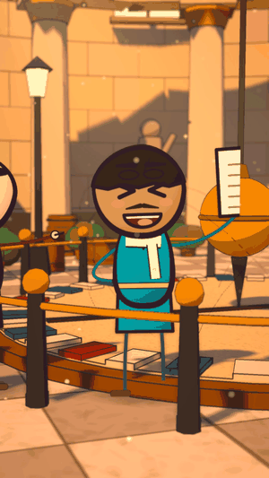
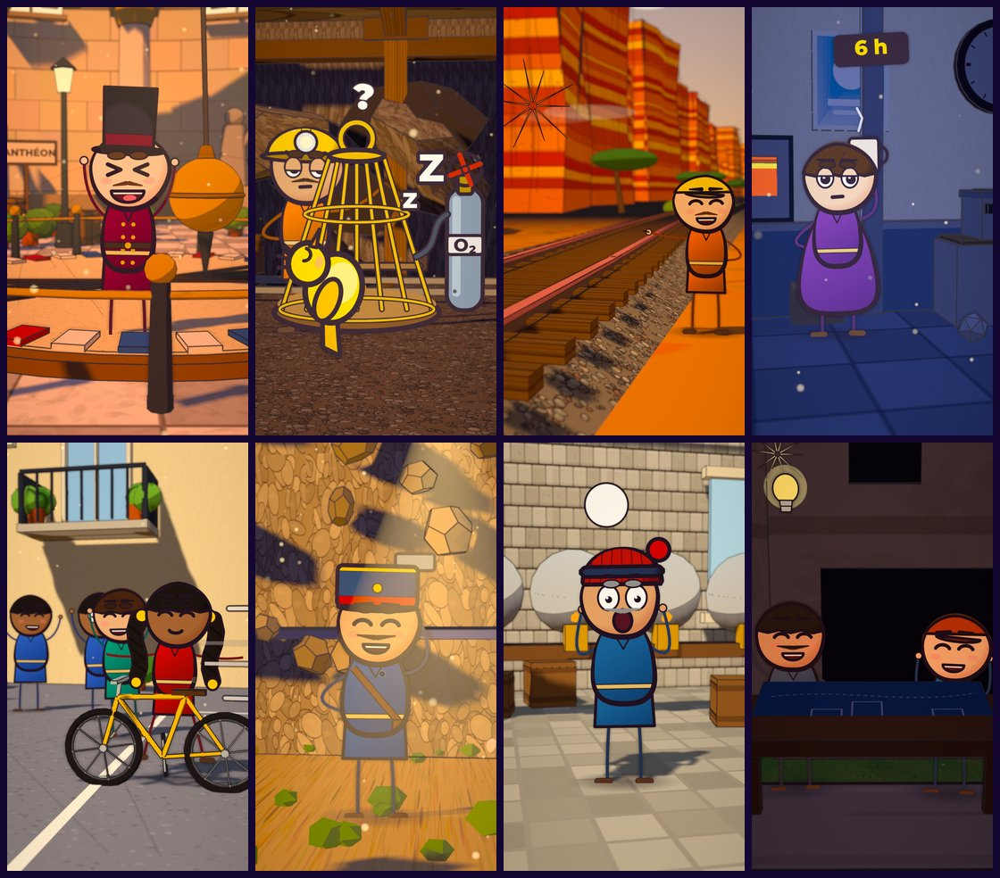
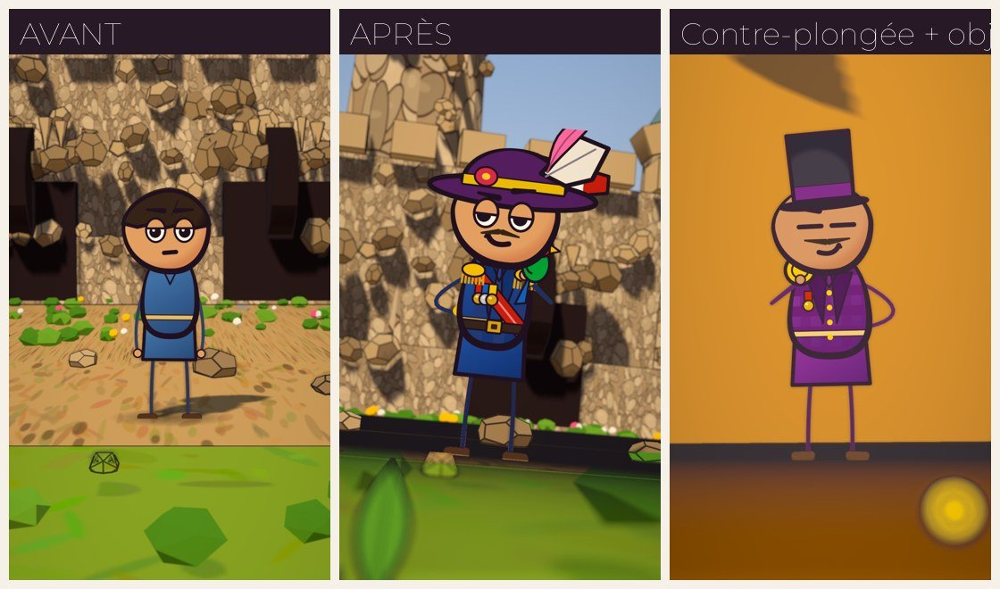
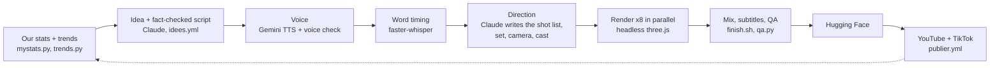

# Studio Pourkoipa 🎬

Animated Shorts factory for the **[@Pourkoipa](https://www.youtube.com/@Pourkoipa)** channel: true, surprising stories in French, featuring 2D bean-headed characters inside a painted 3D world. Drop in a voice track, **Claude directs the video** (shot list, set, camera, sound, subtitles), and GitHub Actions renders it. The MP4 lands on **Hugging Face** (`soradata/studio-anime`), then the **Publication** workflow posts it to YouTube and TikTok.

<p align="center">
  
</p>
<p align="center"><em>The end of an episode: Kipa signs off, the camera glides back to the opening shot and the Short loops seamlessly.</em></p>

## What it makes

Every frame below was rendered by this engine, from episodes in `episodes/`, with no hand drawing:



Two formats alternate: **true stories** (fact-checked, dated, sourced) and **everyday life** (short fictional stories about an emotion everyone knows).
The engine keeps improving; here is the same character before and after the « attitude » update (faces, costumes, low angles, blurred foreground):



## The pipeline



Everything runs in GitHub Actions, triggered on a schedule by cron-job.org: one new video a day, no manual step.
The loop closes on itself: before choosing the next topic, the generator reads how our own videos performed (`stats.md`).

## Usage (from phone or computer)

**Option A: you already have your voice track**
1. On GitHub: `Add file` → `Upload files`, inside an `inbox/<date>-<topic>/` folder (e.g., `inbox/2026-11-20-tour-eiffel/`).
2. Upload `voice.wav` (or `.mp3`) **and** `script.txt` (the exact spoken text).
3. Commit → the **Vidéo** workflow starts automatically (Actions tab, ~30–45 min).
4. The video lands on **Hugging Face** (`soradata/studio-anime/<slug>/`) with its `meta.json` (title, description, hashtags, TikTok caption), ready for the Publication workflow.

**Option B: you want an idea + a script** (your upcoming topics: `sujets.md` list, used by the cron job)
1. Actions → **Idée + script** → `Run workflow`. Leave the topic blank (Claude picks the most viral one) or enter one.
2. Claude fact-checks the story and opens an **issue** with the script.
3. Record it with the Riko voice (Google AI Studio), drop `voice.wav` into the indicated `inbox/` folder → Option A, step 3.
   (Or check `voix_auto` for an automatic Gemini TTS voice: the video pipeline starts right away.)

**Tweaks**: in an issue, write `@claude shot 3 is too dark, and zoom in closer on the chef` → Claude fixes it and reruns the render.

## Channel Voice
By default the channel voice is **Riko** (Gemini prebuilt voice, `gemini-3.8-flash-tts`), set in `brand/voice.json`, with the delivery prompt in `brand/style.txt`.
When a script has no `voice.wav`, the **Vidéo** workflow generates it automatically (needs the `GEMINI_API_KEY` secret).

Optional, an **original** designed voice instead (Gemini Voice Design, prompt in `brand/voice_prompt.txt`):
Actions → **Voix de la chaîne** → `Run workflow`. It replaces `brand/voice.json` with the new `voice_...` id and commits two previews
(`brand/voice_sample.wav`, `brand/voice_test.wav`) you can listen to on GitHub. Not convinced? Edit the prompt and run it again.

## Setup (one time only)
1. **Claude GitHub App**: <https://github.com/apps/claude> → `Install` → `Auracontent` → this repository.
2. **Claude token** → secret **`CLAUDE_CODE_OAUTH_TOKEN`** (see [Getting the Claude token](#getting-the-claude-token) below).
3. **Gemini** (automatic voice) → secret **`GEMINI_API_KEY`**: <https://aistudio.google.com/apikey> → `Create API key`.
4. **YouTube trends** → secret **`YOUTUBE_API_KEY`**: enable *YouTube Data API v3* at
   <https://console.cloud.google.com/apis/library/youtube.googleapis.com>, then create a key at <https://console.cloud.google.com/apis/credentials>.
   Before each idea, `tools/trends.py` ranks the most-viewed videos of the channels in `tendances.json`; Claude uses it to pick a **theme**
   that performs, then writes its own story from web research.
5. **Hugging Face** → secret **`HF_TOKEN`** (*Write* token from <https://huggingface.co/settings/tokens>). Every finished video is uploaded to the
   private dataset **`soradata/studio-anime`** (created on first upload), one folder per video: `<slug>/` with the mp4, `meta.json`,
   `cover.jpg`, `qa_sheet.jpg`. Another dataset: repository variable `HF_DATASET`.
6. Settings → Actions → General → Workflow permissions: **Read and write** (if greyed out, change it first in the organization settings:
   <https://github.com/organizations/Auracontent/settings/actions>, and set *Policies* to **Allow all actions and reusable workflows**).

Secrets go in Settings → Secrets and variables → Actions → **New repository secret**. Never paste a key in a file, an issue or a commit.

## Publishing (YouTube + TikTok via Zernio)
The **Publication** workflow takes the oldest video with `"status": "ready"` on Hugging Face, uploads it to Zernio and publishes it
to YouTube (Short, Education category, AI disclosure on) and TikTok (public, AI label on), each with its own caption from `meta.json`.
Then `meta.json` becomes `"status": "published"` with the Zernio post ids, so a video is never posted twice (if only one platform
fails, the next run retries only that one). Videos published by hand are marked `published` in their `episodes/<slug>/meta.json`.

1. Zernio: connect the YouTube channel and the TikTok account, create an API key → secret **`ZERNIO_API_KEY`**.
2. Actions → **Publication** → `Run workflow` → mode **comptes**: the log lists the account ids.
   Add them as secrets **`ZERNIO_YOUTUBE_ACCOUNT_ID`** and **`ZERNIO_TIKTOK_ACCOUNT_ID`** (leave one out to skip that platform).
   Also accepted: `ZERNIO_API_KEY_P`, `YOUTUBE_ID_COUNT_P`, `TIKTOK_ID_COUNT_P`.
3. Mode **test**: shows exactly what would be sent, publishes nothing.
4. Mode **publier**: publishes one video now.
5. Automatic: add the repository **variable** `PUBLISH_ENABLED` = `true` (Settings → Secrets and variables → Actions → *Variables*).
   Scheduling is done by cron-job.org (Paris time), which calls the GitHub API: `idees.yml` at 10:17 and 22:17 (`{"ref":"main","inputs":{"voix_auto":"true"}}`: script, voice and video follow) and `publier.yml` at 12:07 and 19:07 (`{"ref":"main","inputs":{"mode":"publier"}}`). Token: fine-grained, this repo only, Actions read and write. Disable the cron-job.org jobs to pause.
Options (variables): `TIKTOK_PRIVACY` (default `PUBLIC_TO_EVERYONE`), `YOUTUBE_VISIBILITY` (default `public`), `PUBLISH_AI_LABEL` (`0` to disable).

## Getting the Claude token
`CLAUDE_CODE_OAUTH_TOKEN` is a long-lived token (**valid 1 year**) tied to your Claude **Pro or Max** subscription: the videos use your
subscription, no pay-per-use API bill. It cannot be created from the claude.ai settings; it comes from the `claude setup-token` command.

**A. On your computer** (Windows: PowerShell, macOS/Linux: Terminal)
```bash
# Windows (needs Node.js LTS from nodejs.org):
npm install -g @anthropic-ai/claude-code
#   if PowerShell says scripts are disabled: Set-ExecutionPolicy -Scope CurrentUser RemoteSigned
# macOS / Linux (no Node needed):
curl -fsSL https://claude.ai/install.sh | bash

claude setup-token
```
Your browser opens → log in → **Authorize** → the terminal prints `sk-ant-oat01-…`. Copy it whole.

**B. Without installing anything on your computer** (no disk space, Claude only used on the web)
Use a cloud terminal: a GitHub Codespace (<https://github.com/codespaces/templates> → *Blank* → *Use this template*) or any cloud VS Code.
```bash
curl -fsSL https://claude.ai/install.sh | bash          # or: npx -y @anthropic-ai/claude-code setup-token
BROWSER=false ~/.local/bin/claude setup-token
```
`BROWSER=false` stops the editor from opening a tab by itself (that tab redirects to `localhost` and its code is rejected).
Copy the link **printed in the terminal** (press `c`), open it in a new tab, **Authorize**: the page stays on `platform.claude.com`
and shows a code with a **Copy** button. Paste it in the terminal (right-click → Paste) → Enter → `sk-ant-oat01-…` is printed.
Then delete the Codespace (<https://github.com/codespaces> → `…` → *Delete*).

**Then**: <https://github.com/Auracontent/studio-anime/settings/secrets/actions/new> → Name `CLAUDE_CODE_OAUTH_TOKEN` → paste → **Add secret**.
Run `clear` in the terminal afterwards.

**Troubleshooting**
- *"That code wasn't accepted"*: the code is single-use and only valid for a few minutes, and each retry creates a new link (new `state`).
  Press Enter, use the **new** link, and paste the code within a minute.
- *Page "localhost refused to connect"*: you used the auto-opened tab. Restart with `BROWSER=false` as above.
- **Renewal**: after one year the workflows fail with an authentication error. Run `claude setup-token` again and replace the secret.
- **Leak**: revoke access from the claude.ai settings, generate a new token, replace the secret.

## How It's Built
| Step | Where | Who |
|---|---|---|
| Word timing (faster-whisper in French, aligned to the script) | `tools/timing.py` | Actions |
| Shot list, set, framing, casting, sound effects, still-frame review | `episodes/<slug>/` | **Claude** (`CLAUDE.md` = director's guide) |
| Headless Three.js rendering, 8 slices in parallel | `tools/render.mjs` | Actions (matrix) |
| Synthesized music + sound effects, locked mix (music −12 dB below the voice), subtitles, −14 LUFS, QA check | `tools/finish.sh` | Actions |

- `engine/`: rendering engine (inked 2D cards inside a 3D world, ink pass, depth of field, color grading), `motion.js` (cameras, `frameOn` = close-up framing scaled to the reference).
- `engine/library/`: reusable sets (`paris.js`, `rails.js`, `coupe.js` cutaway, and more), plus `props.js` (set dressing).
- `episodes/`: every produced episode (story, shot list `PLAN.md`, still sheet `stills.jpg`); `_demo-fx` and `_demo-style` show the engine's effects.
- `brand/`: channel logo, banner, and watermark.
- `SKILL.md` + `example/soldier/`: methodology and example from the original kit.

Locally (Linux, macOS, WSL, Onyxia or a container): `bash init.sh` installs everything (system packages, Node 22, a browser for rendering, Python deps, Claude Code; `SKIP_CLAUDE=1` to skip it) — or just `bash tools/setup.sh` if the tools are already there; then `CHROME=/usr/bin/google-chrome node tools/render.mjs episodes/<slug> frames 0-<N-1>` and `bash tools/finish.sh episodes/<slug> frames "Title"`.

Based on the cartoon-short-kit and [mromidev/claude-animated-shorts](https://github.com/mromidev/claude-animated-shorts) (MIT: Pen / heads / faces library, fetched by `setup.sh`).
Fonts: Montserrat and Luckiest Guy (SIL OFL / Apache 2.0).
